# ♿ RotaLivre: rotas acessíveis para pessoas com mobilidade reduzida

Projeto da **Global Solution 2026 (2º semestre), disciplina Android Kotlin Developer**, no desafio **CitizenTech**.

## 👥 Integrantes

| Nome completo                   | RM         |
|---------------------------------|------------|
| _Felipe da Silva Freitas_       | _RM554964_ |
| _Luana Metta Ribeiro Fernandes_ | _RM558314_ |
| _Luísa Souza Santos_            | _RM557799_ |

---

## 🧩 Problema

Quem usa cadeira de rodas, muletas ou carrinho de bebê não sabe com antecedência se o caminho tem calçada quebrada, se existe rampa ou se o elevador da estação está funcionando. Um único obstáculo pode impedir a pessoa de chegar ao destino, obrigando-a a voltar, pedir ajuda ou desistir do trajeto.

## 🎯 Público beneficiado

- Pessoas com deficiência 
- Idosos
- Gestantes
- Pais e mães com carrinho de bebê

## 💡 Proposta

O **RotaLivre** é um mapa colaborativo de obstáculos e da acessibilidade de ruas e estações. Qualquer cidadão pode **reportar um problema** (calçada danificada, falta de rampa, elevador ou escada rolante quebrados), informar **qual perfil de mobilidade é mais afetado** e acompanhar o **status** da ocorrência: pendente, confirmada pela comunidade ou resolvida.

**Diferencial:** o app considera o **tipo de limitação** da pessoa. Cada ocorrência indica quem ela prejudica, e a tela inicial permite filtrar por perfil (ex.: um cadeirante vê apenas o que bloqueia uma cadeira de rodas). Essa informação é a base para, numa evolução futura, calcular rotas que levem em conta o tipo de limitação e não só a distância.

> **Observação:** este é um protótipo acadêmico. Os dados são cadastrados pelos próprios usuários e ficam salvos no aparelho. O app **não** está integrado a sistemas reais do Metrô, da CPTM ou da prefeitura, e o cálculo de rota acessível em mapa está planejado como próxima etapa.

## 🌍 ODS relacionados

- **ODS 11: Cidades e comunidades sustentáveis.** A meta 11.2 fala em transporte acessível para todos, com atenção a pessoas com deficiência e idosos, e a meta 11.7 em espaços públicos seguros, inclusivos e acessíveis. O app mapeia exatamente as barreiras nesses espaços e no acesso ao transporte.
- **ODS 10: Redução das desigualdades.** A meta 10.2 trata da inclusão social de todas as pessoas, independentemente de deficiência ou idade. Ao dar visibilidade aos obstáculos e permitir que a comunidade os acompanhe, o app reduz a desvantagem de quem tem mobilidade reduzida para circular pela cidade.

## ✅ Funcionalidades

- **Tela inicial** com apresentação do app (objetivo, público e ODS) e lista de ocorrências
- **Filtro por perfil de mobilidade** (cadeira de rodas, muletas ou andador, carrinho de bebê, idosos e gestantes)
- **Cadastro de ocorrência** com tipo (e sugestões rápidas), localização, perfil afetado e descrição
- **Validação do formulário**: todos os campos são obrigatórios e a descrição exige no mínimo 10 caracteres (espaços em branco não contam)
- **Alteração de status**: Pendente → Confirmado pela comunidade (Validado) → Resolvido, ou de volta para Pendente
- **Exclusão** com diálogo de confirmação
- **Mensagens de confirmação** (Snackbar) ao registrar, alterar status e excluir
- **Estado vazio** com orientação ao usuário, inclusive quando o filtro não encontra resultados
- **Persistência local com Room**: os registros continuam salvos após fechar e reabrir o app

## 🛠️ Tecnologias utilizadas

| Tecnologia | Uso |
|---|---|
| Kotlin 1.9.22 | Linguagem |
| Jetpack Compose + Material 3 (BOM 2024.02.00) | Interface: Scaffold, TopAppBar, LazyColumn, Card, OutlinedTextField, Button, FilterChip, Snackbar, AlertDialog |
| Navigation Compose 2.7.7 | Navegação entre as 3 telas (Início, Cadastro, Detalhes) com argumento de id |
| ViewModel + StateFlow (Lifecycle 2.7.0) | Gerenciamento de estado |
| Room 2.6.1 (KSP) | Banco de dados local |
| Coroutines + Flow | Operações assíncronas e atualização automática da interface |

**Android:** minSdk 24 (Android 7.0), targetSdk 34.

## 🗂️ Organização do código

```
app/src/main/java/com/fiap/rotalivre/
├── MainActivity.kt
├── data/
│   ├── entity/        → Ocorrencia (entidade Room), StatusOcorrencia, PerfilAfetado
│   ├── dao/           → OcorrenciaDao (inserir, listar, observar, atualizar, excluir)
│   ├── database/      → AppDatabase (Room)
│   └── repository/    → OcorrenciaRepository
├── viewmodel/         → OcorrenciaViewModel (estado da lista, filtro, mensagens)
└── ui/
    ├── navigation/    → AppNavigation (NavHost e rotas)
    ├── home/          → HomeScreen (apresentação, filtro e lista)
    ├── cadastro/      → CadastroScreen (formulário com validação)
    ├── detalhes/      → DetalhesScreen (detalhes, status e exclusão)
    ├── components/    → StatusBadge
    └── theme/         → Cores, tipografia e tema
```

Fluxo dos dados: **Tela (Compose) → ViewModel → Repository → DAO → Room**. A lista e os detalhes observam o banco via `Flow`, então qualquer alteração aparece na tela automaticamente.

## ▶️ Como executar

1. Instale o **Android Studio** (versão Hedgehog ou mais recente).
2. Descompacte o `.zip` e, no Android Studio, vá em **File → Open** e selecione a pasta do projeto.
3. Aguarde o **Gradle Sync** terminar (na primeira vez ele baixa as dependências).
4. Crie ou inicie um emulador (**Device Manager**) com Android 7.0 ou superior, ou conecte um celular com a depuração USB ativada.
5. Clique em **Run ▶** (Shift + F10).

---

## 📱 Fluxo principal e evidências

**Fluxo:** a pessoa abre o app e vê a apresentação e as ocorrências → toca em **"Reportar problema"** → preenche o formulário (o app impede salvar com campos inválidos) → volta à lista com a mensagem de sucesso → toca no card para ver os **detalhes** → **confirma**, marca como **resolvido** ou **exclui** a ocorrência → fecha e reabre o app e os dados continuam lá.

### 1. Tela inicial (sem registros)

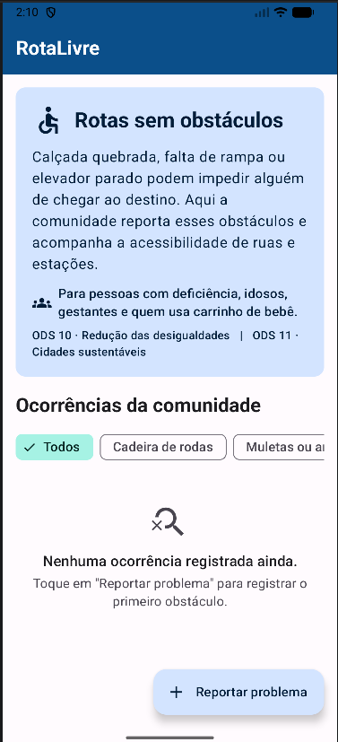

### 2. Tela para reportar ocorrências

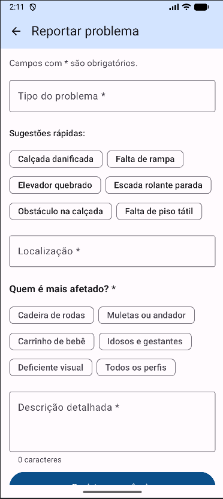

### 3. Registro criado

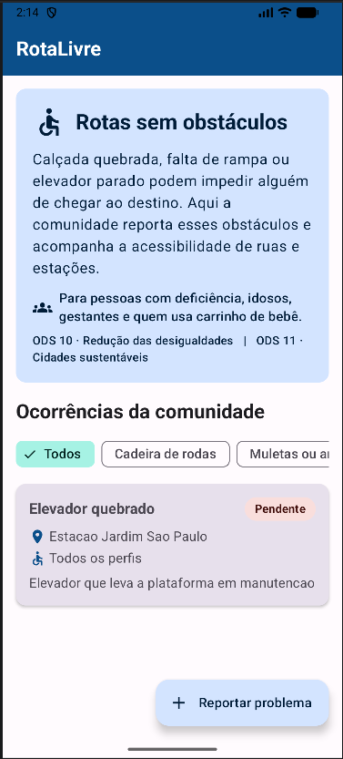

### 4. Ação adicional: alteração de status

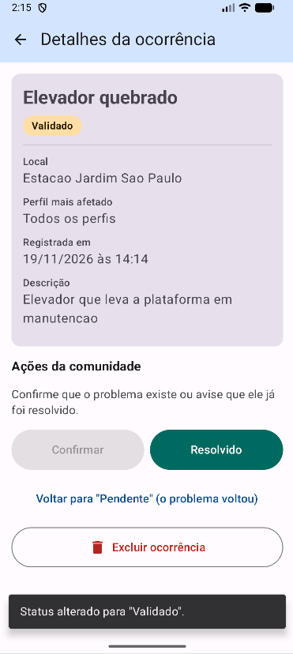

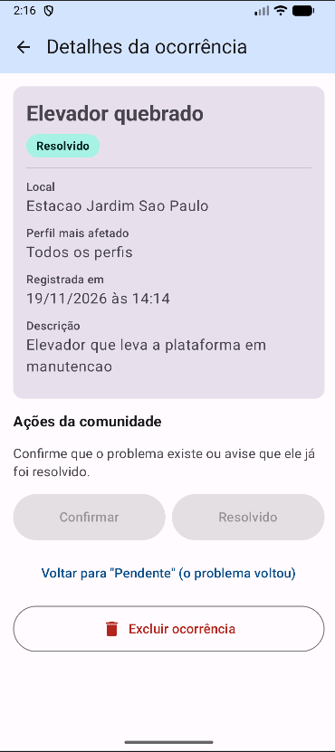

### 5. Filtro por perfil de mobilidade

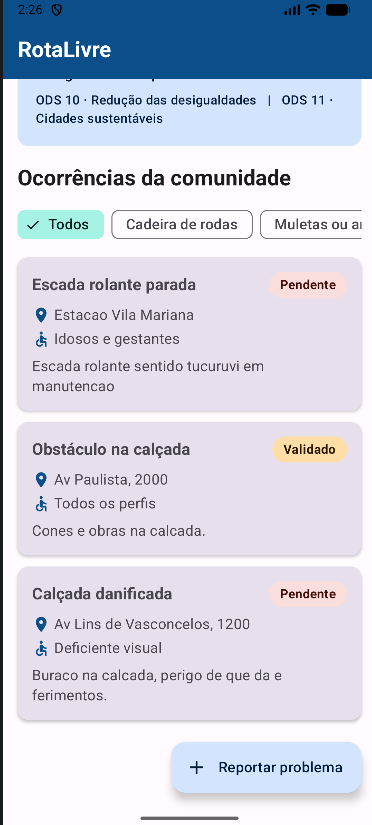

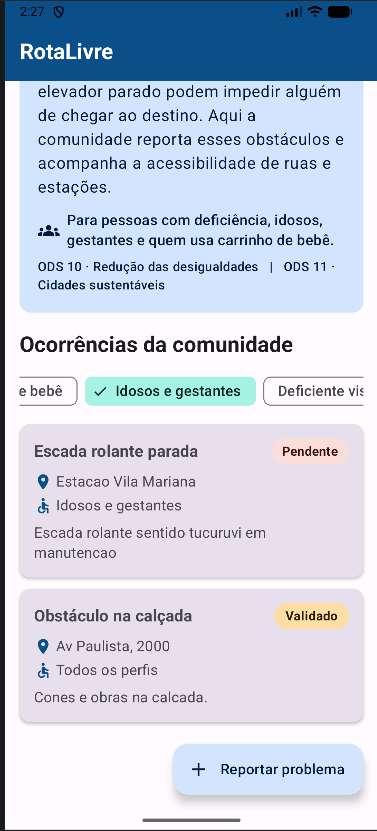

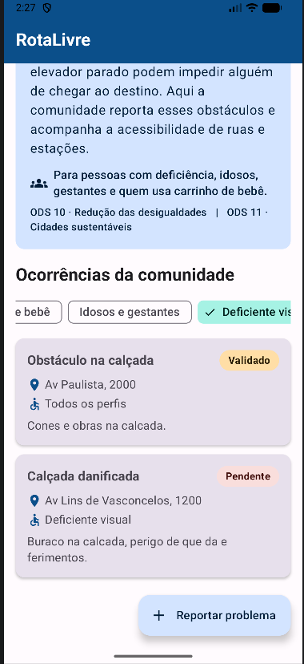

### 6. Exclusão

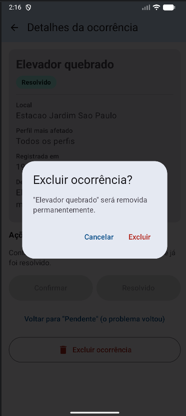

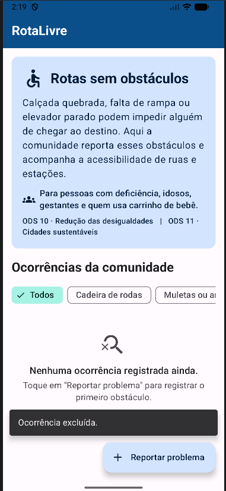

### 7. Permanência após fechar e reabrir o app

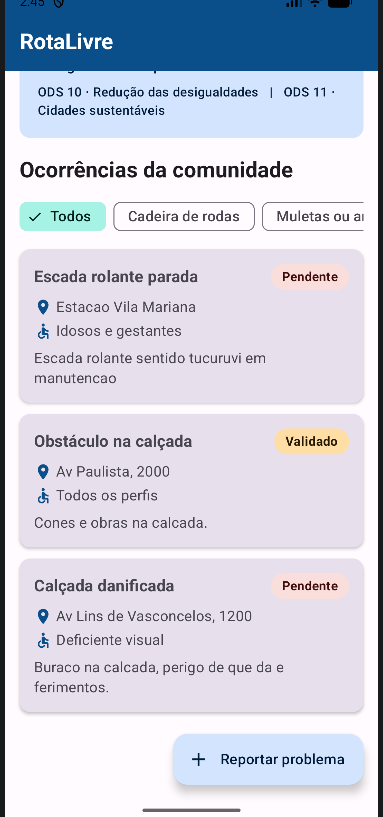
